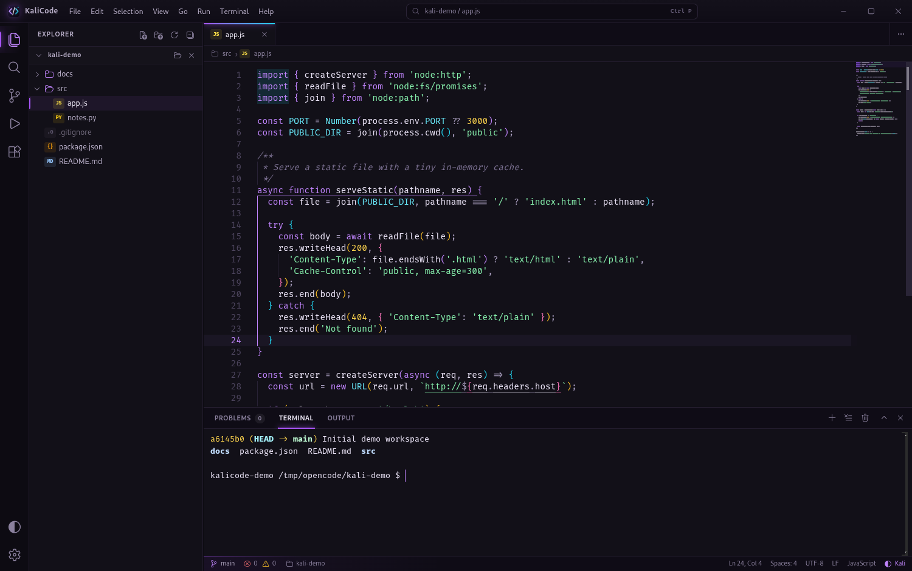
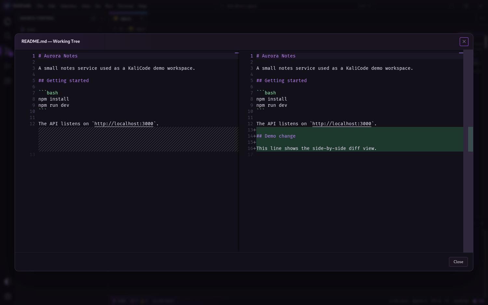

# KaliCode

**A fast, Kali-native desktop code workspace** — Monaco editor, a real PTY
terminal, Git, project-wide search, and run tools in a compact VS Code-style
shell.

[](LICENSE)
[](../../releases/latest)
[](https://github.com/SaiKishore6336/kalicode/actions/workflows/ci.yml)




## Highlights

- **Editor** — Monaco with syntax highlighting for 90+ languages, bracket-pair
  guides, minimap, sticky scroll, multi-cursor, document/selection formatting,
  find and replace, and live diagnostics for TypeScript, JavaScript, JSON, CSS,
  and HTML. Python and shell files are checked with the real interpreters.
- **Workspace explorer** — lazy folder tree, file-type badges, hidden-file
  toggle, inline create/rename/trash, drag-and-drop opening, and a 30,000-file
  Quick Open index.
- **Search and replace** — case-sensitive, whole-word, and regex search across
  the workspace with highlighted matches and file-level replace.
- **Source control** — branch display and switching, stage/unstage files or
  everything, commit, and side-by-side diffs against `HEAD` or the index.
- **Integrated terminal** — a real PTY-backed shell with copy/paste, resize,
  links, themes, and multiple sessions.
- **Run panel** — one-click run for Python, Node, TypeScript, shell, Ruby, PHP,
  Go, Rust, C/C++, Java, and more. Detects `package.json` scripts, Makefile
  targets, pytest, Django, and Docker Compose tasks.
- **Four themes** — Kali, Midnight, Graphite, and Daylight, each with matching
  editor and terminal palettes.
- **Session restore** — reopens your last folder, files, and active tab.
  Folders or files can also be passed as launch arguments.
- **Desktop integration** — installable `.deb` or per-user `install.sh`, both
  with an application-menu entry, icon, and `kalicode` command.

## Installation

### Debian package (recommended)

Download the latest `kalicode_<version>_amd64.deb` from
[Releases](../../releases/latest), then:

```bash
sudo apt install ./kalicode_1.0.0_amd64.deb
```

Launch **KaliCode** from the application menu, or run `kalicode`.

The package bundles Electron, so Node.js is not required. To build it
yourself:

```bash
corepack npm install
corepack npm run build:deb
# -> dist-packages/kalicode_1.0.0_amd64.deb
```

### Per-user install from a checkout

```bash
./install.sh
```

This installs under `~/.local/share/kalicode`, adds `~/.local/bin/kalicode`
and a menu entry, and writes an uninstaller next to the app. Options:

```bash
./install.sh --system      # /opt/kalicode + /usr/local/bin (uses sudo)
./install.sh --prefix DIR  # self-contained install under DIR
./install.sh --no-menu     # skip the menu entry
```

### Run from source

Requires Node.js 22+ (with Corepack), Python 3, and Git (optional).

```bash
corepack npm install
corepack npm run build
corepack npm start
```

Open a workspace directly:

```bash
corepack npm start -- ~/Projects/my-app
corepack npm start -- ~/Projects/my-app/src/main.py
```

Rebuild and launch in one step:

```bash
corepack npm run rebuild
```

Frontend development with Vite's dev server:

```bash
corepack npm run dev:web       # http://localhost:5173
KALICODE_DEV=1 corepack npm start
```

## Screenshots

### Side-by-side Git diff



## Keyboard shortcuts

| Shortcut | Action |
| --- | --- |
| `Ctrl+P` | Quick Open |
| `Ctrl+Shift+P` / `F1` | Command Palette |
| `Ctrl+Shift+O` | Open Folder |
| `Ctrl+O` | Open File |
| `Ctrl+S` / `Ctrl+Shift+S` | Save / Save As |
| `Ctrl+W` | Close Editor |
| `Ctrl+B` | Toggle Sidebar |
| `Ctrl+J` / `` Ctrl+` `` | Toggle Panel / Terminal |
| `Ctrl+Shift+E` | Explorer |
| `Ctrl+Shift+F` | Search in Files |
| `Ctrl+Shift+G` | Source Control |
| `Ctrl+Shift+D` | Run and Debug |
| `F5` | Run Active File |
| `F11` | Full Screen |
| `Ctrl+,` | Settings |
| `Alt+1…9` | Switch editor tabs |

Monaco's standard editing shortcuts (`Ctrl+F`, `Ctrl+H`, `Ctrl+D`,
`Alt+Up/Down`, and so on) work inside the editor.

## Configuration

Settings are stored in `~/.config/KaliCode/settings.json` and can be edited
from the Settings dialog (`Ctrl+,`). Common options:

| Key | Default | Description |
| --- | --- | --- |
| `theme` | `kali` | `kali`, `midnight`, `graphite`, or `daylight` |
| `fontSize` | `14` | Editor font size |
| `fontFamily` | `Fira Code, …` | Editor font stack |
| `tabSize` / `insertSpaces` | `4` / `true` | Indentation |
| `wordWrap` / `minimap` / `lineNumbers` | `false` / `true` / `true` | Editor behavior |
| `autoSave` | `false` | Save after typing stops |
| `restoreSession` | `true` | Restore the previous workspace |
| `terminalShell` | `$SHELL` | Shell used by new terminals |
| `terminalFontSize` | `13` | Terminal font size |
| `hiddenFiles` | `true` | Show dotfiles in the explorer |

Terminal sessions use `$SHELL` (falling back to `/bin/bash`), and Python tools
use `$PYTHON` or `python3` from `PATH`. No user or machine path is hardcoded.

## How it works

KaliCode is plain JavaScript with no framework:

- **Renderer** (`src/`) — ES modules that build the VS Code-style shell and
  wire Monaco, xterm.js, the explorer, search, Git, and settings together.
- **Main process** (`electron/main.cjs`) — windows, IPC, filesystem access,
  Git subprocesses, project search, PTY lifecycle, and the custom `app://`
  protocol that serves the production bundle.
- **Preload** (`electron/preload.cjs`) — a narrow `window.kali` API exposed
  through `contextBridge`.
- **PTY bridge** (`electron/pty_bridge.py`) — a Python adapter that forwards
  terminal I/O as base64 JSON frames over stdio.

### Project layout

```
kalicode/
├── electron/
│   ├── main.cjs          # windows, IPC, files/Git/search, PTY lifecycle
│   ├── preload.cjs       # contextBridge API exposed as window.kali
│   └── pty_bridge.py     # Python PTY adapter (base64 JSON frames)
├── src/
│   ├── main.js           # Vite entry point
│   ├── app.js            # KaliCodeApp composition root
│   ├── monaco.js         # editor setup, themes, language detection
│   ├── terminal.js       # xterm.js terminal manager
│   ├── ui.js             # quick pick, modals, menus, toasts
│   ├── styles.css        # application shell and four themes
│   └── methods/          # workspace, tabs, search, git, run, settings, commands
├── docs/                 # screenshots
├── assets/               # logo and application icon
├── scripts/
│   ├── build-deb.sh      # self-contained .deb builder
│   └── install-desktop-entry.sh
├── install.sh            # per-user, system-wide, or prefix installer
├── index.html
└── vite.config.js
```

## Development

```bash
corepack npm run check    # syntax-check the Electron entry points
corepack npm run build    # production renderer bundle
corepack npm run build:deb
```

The app can be tested against any folder:

```bash
corepack npm start -- /path/to/a/project
```

## Security

- `contextIsolation` is enabled and Node integration is disabled in the
  renderer.
- The renderer only reaches privileged APIs through the `window.kali` preload
  bridge.
- Production files are served from a privileged custom `app://` protocol
  rooted at `dist/`.
- External navigation is denied and opened in the system browser instead.

See [SECURITY.md](SECURITY.md) for reporting vulnerabilities.

## Contributing

Contributions are welcome. Please read [CONTRIBUTING.md](CONTRIBUTING.md)
before opening a pull request.

## License

[MIT](LICENSE) © 2026 Sai Kishore
